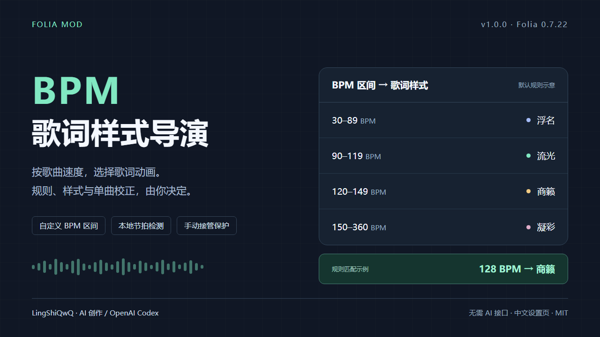
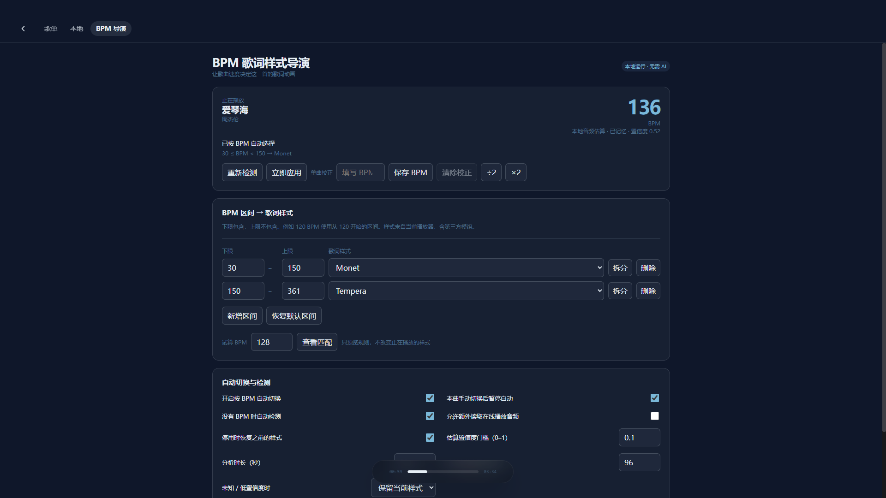

# BPM 歌词样式导演 · v1.0.0

根据歌曲的 BPM 区间，自动选择 Folia 已加载的歌词动画；提供中文设置页、单曲 BPM 校正、本地音频估算及手动接管保护。

**开发方式：AI 创作（OpenAI Codex）；需求、维护与发布：LingShiQwQ。** 运行时不调用 AI 服务，不需要 API Key。

## 安装

1. 使用 **Folia 0.7.22 桌面版**，在设置中开启模组系统。
2. 下载 [v1.0.0 安装包](https://github.com/LingShiQwQ/folia-bpm-style-director/releases/download/v1.0.0/bpm-style-director-1.0.0.zip)，拖进 Folia 的模组管理面板并启用。
3. 按 Ctrl+K，搜索“BPM 导演：打开设置”；也可在首页或播放侧栏打开“BPM 导演”页签。

社区发布包没有 Folium 官方签名，安装时显示“未验证”。官方模组市场是否收录，由维护者审查决定。

## 能做什么

- 自定义 BPM 区间与目标动画，支持当时已加载的内置和第三方模式。
- 优先使用单曲手动校正、歌曲 BPM、Folia 已有分析缓存，再使用本模组保存的估算或本地检测。
- 手动切换歌词样式后，本曲默认暂停自动选择；下一首恢复。
- 快速切歌取消旧检测，停用时恢复本模组接管前的模式及随机开关。
- 本地保存规则和最多 500 首歌的 BPM 记忆，不改写音乐文件。

默认规则：

| BPM | 样式 |
|---|---|
| 30 ≤ BPM < 90 | 浮名 |
| 90 ≤ BPM < 120 | 流光 |
| 120 ≤ BPM < 150 | 商籁 |
| 150 ≤ BPM ≤ 360 | 凝彩 |

BPM 表示速度，不等同于情绪。自动估算可能存在半拍、倍拍误差，可在界面中按 ÷2、×2 或填写单曲 BPM 校正。

## 兼容限制

**只支持 Folia 0.7.22。** 设置、事件、命令、生命周期及存储使用 Folium 的当前接口。切换现有内置模式仍需 `folium.internals`；当前公开 API 没有替代项，Folium 2 将删除它，因此仍会出现弃用提示，不能承诺兼容 Folium 2。

不要删除宿主版本限制强行启用。与其它自动选择歌词样式的模组同时使用，可能互相覆盖。音频必须能被当前播放和解码环境读取；过低置信度、静音或不可读取时不会强行切换。

## 权限与数据

唯一声明权限为 `filesystem.data`，用来通过 `folium.storage` 保存规则、检测记忆及手动校正。还会只读访问当前歌曲、已加载动画列表和 Folia 节拍缓存，并读取当前播放音频用于本地估算；不写宿主缓存，不上传音频、歌词或 BPM，不下载并执行远程代码。

“允许额外读取在线播放音频”默认关闭；启用后只尝试读取当前播放 URL，受原来源的访问限制约束。未声明 `embedOrigins`、实验接口或 main 入口。

## 文档与验证

- [完整使用说明](bpm-style-director/使用说明.md)
- [AI 创作声明](docs/AI_DISCLOSURE.md)
- [验证结果及边界](docs/VALIDATION.md)
- [官方模组市场提交资料](docs/MARKETPLACE_SUBMISSION.md)
- [v1.0.0 发布说明](docs/RELEASE_NOTES_v1.0.0.md)

开发验证：Node.js 22+ 运行 `npm test`。Windows 安装 Chrome 后可运行 `npm run test:ui`；也可通过 `CHROME_PATH` 指定 Chrome 可执行文件。浏览器检查使用独立临时用户目录与演示歌曲，不访问真实曲库。

源码与模组采用 [MIT](LICENSE) 许可证。项目与 Folia 官方没有隶属关系。
